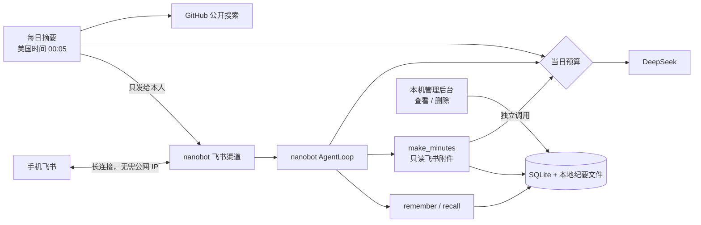
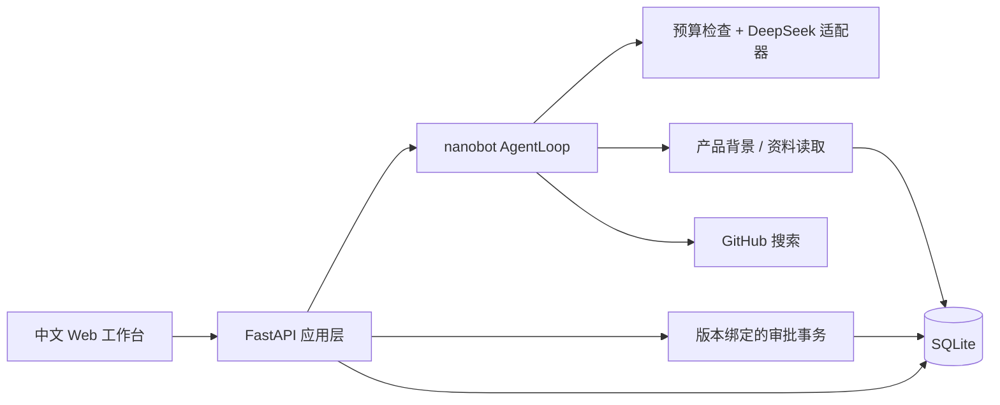

# 小纪 · 飞书里的私人 AI 秘书

> **转型中（2026-10-20）**：本项目原名「PM 灵感台」，是一个找产品机会、写 PRD 的本地工作台。写 PRD 的能力已经交给另一个项目 [AIPM 工坊](https://github.com/ZeroOnehub/aipm-workbench)，这里改造成住在飞书里的私人秘书：
> - 在手机飞书里把会议录音（或转写稿）交给它，它整理成纪要；
> - 只记住你明确让它记住的事；
> - 所有对外动作都要你确认，有每日预算上限。
>
> 下面先是已经能用的飞书小纪，再是 v0 基线（PM 灵感台 MVP）的说明。

## 飞书里的小纪（2026-10-20 起可用）

| 你在手机飞书里 | 小纪做什么 |
|---|---|
| 发一份会议 / 课堂转写稿（docx、txt、md、pdf） | 整理成纪要：结论与决策（附原话）、待办（负责人、截止时间、出处）、讨论要点、待确认问题；本机存一份 |
| 说「记下：……」 | 记住这件事，并复述一遍 |
| 问「上次周会定了什么」「XX 什么时候交」 | 从记事和纪要里查，说明出处；查不到就说没有，不编 |
| （自动）每天美国太平洋时间 00:05 | 推送前一天的摘要：当天的纪要和记事，加上近 7 天新冒头的 AI 开源项目（是什么、为什么值得看、面试可能怎么问），推过的不重复 |
| 说「摘要」 | 立即生成到目前为止的今日摘要 |

**安全设计**
- 工具表是锁死的：只有 `make_minutes`、`remember`、`recall`、`daily_digest` 四个。nanobot 的 22 个默认工具（执行命令、读写文件、联网、发消息……）在注册时就被丢弃，有测试覆盖。
- 只能读你在飞书里发来的附件，其他路径一律拒绝（包括符号链接）。
- 只回应 `allowFrom` 名单里的人；陌生人只会收到配对码，要在本机批准才能用。
- 每次调用模型前先预留当日预算，超出就停。纪要用一次独立调用完成，转写稿不进聊天历史，后面的对话不会反复为它付费。
- 删除记录只能在本机管理后台做，模型没有删除能力。

**启动**
```bash
# 1. 第一次：用手机飞书扫码创建机器人（凭据存在 .data/，不进仓库）
.venv/bin/nanobot channels login feishu --config .data/nanobot/config.json
# 2. 在 .env 里填 DEEPSEEK_API_KEY
# 3. 启动，Ctrl+C 停止
.venv/bin/python xiaoji.py
```
小纪跑在你的 Mac 上：Mac 睡眠时收不到消息；错过的摘要在下次启动后补发最近一天。音频直接转写还在计划中。

摘要的时区和时刻可以在 `.env` 里改：`XIAOJI_DIGEST_TZ`（默认 `America/Los_Angeles`）、`XIAOJI_DIGEST_AT`（默认 `00:05`）。



## v0 基线：PM 灵感台

面向 AI 产品经理的本地个人助理：从研究线索发现机会，把选中的方向变成 PRD，并记住你明确保存的产品背景。

**当前版本：可运行的本地 MVP。** 演示模式已通过浏览器端流程验证。真实模式已实现 DeepSeek 接口适配，但未提供 API key，尚未完成真实模型验收。演示正文是固定模板，不能用于评估模型质量。

## 快速启动

本机依赖已经安装：

```bash
.venv/bin/python run.py
```

打开 http://127.0.0.1:8787 。默认只监听本机，不需要 Node。停止服务使用 Ctrl+C。

新环境（Python 3.11+）：

```bash
python3 -m venv .venv
NANOBOT_SKIP_WEBUI_BUILD=1 .venv/bin/pip install -r requirements.lock
.venv/bin/python run.py
```

锁定依赖基于 macOS / Python 3.13 验证；其他平台如遇平台包兼容问题，可使用 requirements.txt 重新解析，保留新的锁定结果。上游提交始终固定。

## 配置真实 DeepSeek

```bash
cp .env.example .env
```

在本地编辑 `.env`：

```dotenv
PM_MODE=live
DEEPSEEK_API_KEY=你自己的密钥
DEEPSEEK_BASE_URL=https://api.deepseek.com
DEEPSEEK_MODEL=deepseek-flash
PM_DAILY_BUDGET_USD=1
PM_INPUT_PRICE=0.30
PM_OUTPUT_PRICE=1.20
```

重启服务。不要把 key 发到聊天、截图或 Git。模型名称和每百万 token 价格请以 [DeepSeek 官方页面](https://api-docs.deepseek.com/quick_start/pricing/)为准；换模型必须同步改价格。应用估算按输入价格上限计费，不区分缓存优惠。失败请求保留预算预留，避免把不确定的已收费请求当成免费。

真实模式会将任务、已保存记忆和资料送到配置的模型接口；GitHub 工具会将模型生成的搜索词送到 GitHub。数据本地持久化不代表真实模式完全离线。请只添加允许用于这些服务的资料。

## 使用

1. 在「产品记忆」保存目标用户、产品阶段与文档偏好；明确点击保存才写入长期记忆。
2. 在「研究资料」粘贴访谈或竞品资料，并保留标题、链接和时间。仅贴 URL 不会抓取网页正文。
3. 在「灵感工作台」描述问题，选择机会发现。真实模式可按请求调用 GitHub 搜索，演示模式只调用本地背景读取。
4. 在结果上点「以此生成 PRD」，输入选中的具体机会与补充要求，生成并下载 Markdown。
5. 编辑或删除时进入「操作审批」，检查原内容和拟替换内容后执行或拒绝。

每次生成均保存为新草稿。覆盖编辑只递增版本号，**当前没有历史版本回滚**；需要保留旧版时先下载。审批有效期 15 分钟，记录版本变化后旧批准不能执行。

## 已实现

- 六个中文页面：工作台、机会/文档库、研究资料、产品记忆、审批、模型状态。
- 复用 nanobot AgentLoop、Tool 和 Nanobot SDK 事件；只保留 `read_context` 与 `search_github` 两个只读工具。
- 机会发现与 PRD 两条工作流，关联已有草稿，安全文本渲染和 Markdown 下载。
- SQLite 持久化；审批事务保证拒绝不写入、重复审批不重放、旧版本不覆盖。
- 逐请求预算预留、6 次模型调用上限、180 秒任务超时、单任务并发限制。
- 本机会话 Cookie、CSRF/Origin/Host 校验，无任意路径读写 API。

## 架构



用户的长期记忆由应用数据库管理。每个 Agent 任务使用临时上游工作空间与 ephemeral 会话，结束后清理，避免上游隐式长期记忆绕过授权。产物作为下一轮上下文显式选择；没有额外维护连续聊天记录。

## 测试

```bash
.venv/bin/python -m pytest -q
.venv/bin/pip check
```

10 项测试通过：真实 nanobot 循环上的演示工具调用、PRD、显式记忆持久化/删除、审批拒绝/重复/版本冲突/过期、预算并发与重启、API 校验、真实适配器的模拟响应、禁止 shell。真实 GitHub 搜索已成功检索 HKUDS/nanobot；真实 DeepSeek 仍待凭证验收。浏览器已验证机会 → PRD 的演示闭环。

## 数据与限制

数据目录 `.data/`，备份时先停止服务再复制目录。日志不包含 key 和完整正文。删除长期记忆不自动删除既有文档中的引用；审批待审内容也是本地数据。服务重启会终止未完成任务；已保存数据和预算保留，临时任务状态不恢复。

首版不包括自动定时任务、MCP、飞书发布、多用户、任意网页抓取、PDF/Word 导出、文件上传和录制 GIF。来源真实性与 PRD 质量还需要用真实模型和真实资料评测，不能把提示词约束视为完全可靠的事实校验器。

## 上游与贡献

基于 [HKUDS/nanobot](https://github.com/HKUDS/nanobot)，实际检查并安装的提交：`dca49c258a9d7efb1475dd79c7a3fd2e5b746bd2`（源码标注 0.3.5）。我们新增产品经理工作流、本地工作台、显式记忆、应用审批和预算；Agent 引擎来自上游。上游原始许可证与声明保存在 [third_party](third_party/)。本仓库新增代码采用 MIT，见 LICENSE。

更多记录： [选型](docs/选型记录.md)、[规格](docs/SPEC.md)、[实际接口说明](docs/源码借鉴.md)、[开发日志](docs/DEVLOG.md)。
